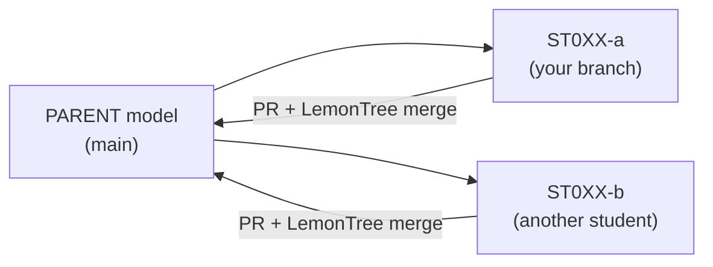

# EA model – how we work (STHDF 2026-2027)

> 🚧 **Draft — working on content.** Steps are confirmed after the lecture; dates and the assignment will be announced by the lecturer.

This page is **specific to our class**. The general, reusable how-to is the KNIFE article
[K000002 – Git workflow for EA models](../../knifes/K000002-git-workflow-for-ea-models/index.md).

## The idea

A minimal **parent model** lives in one repository. Every student works on **their own branch**,
changes **their own package**, and brings it back by **Pull Request** and a **three-way merge in LemonTree**.
The goal is to experience a real merge, not to model the whole faculty.



## Where things are

| What | Where |
|---|---|
| Parent model repository | [06-STH-Projects/ea_model_sthdf_2026-2027](https://github.com/06-STH-Projects/ea_model_sthdf_2026-2027) |
| Model file | `model/sthdf_parent.qea` |
| EA licence on your laptop | [K000001 – Enterprise Architect licence on your own laptop](../../knifes/K000001-EA-licence-for-own-laptops/index.md) |

## Our rules

1. **One package, one owner** — name your package with your ID (`ST0XX`).
2. **Always `git pull` first.**
3. **Branch name:** `ST0XX-package-name`.
4. **Save the model and close EA before committing** — the `.qea` file must be released.
5. **Never merge a `.qea` in the GitHub UI.** Conflicts are resolved locally in LemonTree: *parent* (common ancestor), *ours*, *theirs*.
6. **Small changes, frequent commits.**

## Quick start

```bash
git clone https://github.com/06-STH-Projects/ea_model_sthdf_2026-2027.git ea-model
cd ea-model
git switch -c ST0XX-package-name
# open model/sthdf_parent.qea in EA, change your package, save and CLOSE EA
git add model/sthdf_parent.qea
git commit -m "ST0XX: what changed"
git push -u origin ST0XX-package-name
# then open a Pull Request on GitHub
```

## Assignment and dates

*To be announced by the lecturer.*
