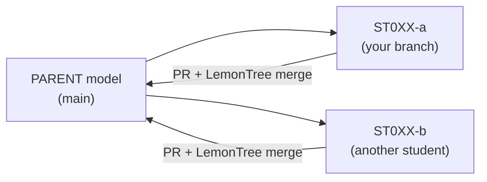

# EA model – ako pracujeme (STHDF 2026-2027)

> 🚧 **Rozpracované — pracujeme na obsahu.** Kroky potvrdíme po prednáške; termíny a zadanie oznámi vyučujúci.

Táto stránka je **špecifická pre našu triedu**. Všeobecný, znovupoužiteľný návod je KNIFE
[K000002 – Git workflow pre EA modely](../../knifes/K000002-git-workflow-pre-ea-modely/index.md).

## Princíp

V jednom repozitári je minimalistický **rodičovský (parent) model**. Každý študent pracuje na **vlastnej vetve**,
mení **vlastný balík** a vracia ho cez **Pull Request** a **trojcestný merge v LemonTree**.
Cieľom je zažiť skutočný merge, nie namodelovať celú fakultu.



## Kde čo je

| Čo | Kde |
|---|---|
| Repozitár s parent modelom | [06-STH-Projects/ea_model_sthdf_2026-2027](https://github.com/06-STH-Projects/ea_model_sthdf_2026-2027) |
| Súbor modelu | `model/sthdf_parent.qea` |
| Licencia EA na vlastnom notebooku | [K000001 – Enterprise Architect licence on your own laptop (EN)](../../../en/knifes/K000001-EA-licence-for-own-laptops/index.md) |

## Naše pravidlá

1. **Jeden balík = jeden vlastník** — balík pomenuj svojím ID (`ST0XX`).
2. **Vždy najprv `git pull`.**
3. **Názov vetvy:** `ST0XX-nazov-balika`.
4. **Pred commitom ulož model a zavri EA** — súbor `.qea` musí byť uvoľnený.
5. **`.qea` sa nemerguje v GitHub UI.** Konflikty riešiš lokálne v LemonTree: *parent* (spoločný predok), *ours*, *theirs*.
6. **Malé zmeny, časté commity.**

## Rýchly štart

```bash
git clone https://github.com/06-STH-Projects/ea_model_sthdf_2026-2027.git ea-model
cd ea-model
git switch -c ST0XX-nazov-balika
# otvor model/sthdf_parent.qea v EA, zmeň svoj balík, ulož a ZAVRI EA
git add model/sthdf_parent.qea
git commit -m "ST0XX: popis zmeny"
git push -u origin ST0XX-nazov-balika
# potom otvor Pull Request na GitHube
```

## Zadanie a termíny

*Oznámi vyučujúci.*
